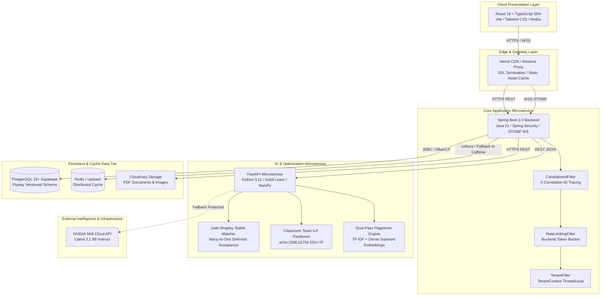
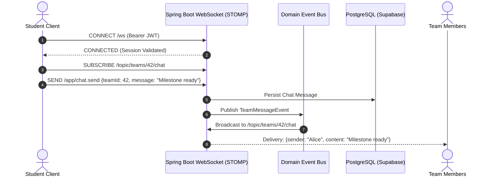

# Skill Sync — System Design & Architecture Specification

```
   ███████╗██╗  ██╗██╗██╗     ██╗         ███████╗██╗   ██╗███╗   ██╗ ██████╗
   ██╔════╝██║ ██╔╝██║██║     ██║         ██╔════╝╚██╗ ██╔╝████╗  ██║██╔════╝
   ███████╗█████╔╝ ██║██║     ██║         ███████╗ ╚████╔╝ ██╔██╗ ██║██║     
   ╚════██║██╔═██╗ ██║██║     ██║         ╚════██║  ╚██╔╝  ██║╚██╗██║██║     
   ███████║██║  ██╗██║███████╗███████╗    ███████║   ██║   ██║ ╚████║╚██████╗
   ╚══════╝╚═╝  ╚═╝╚═╝╚══════╝╚══════╝    ╚══════╝   ╚═╝   ╚═╝  ╚═══╝ ╚═════╝
           Enterprise Capstone Project Collaboration Platform
```

---

## 📑 Table of Contents
1. [Executive Summary & System Goals](#1-executive-summary--system-goals)
2. [High-Level Architectural Topology](#2-high-level-architectural-topology)
3. [Multi-Tier Component Architecture](#3-multi-tier-component-architecture)
4. [Design Patterns Catalog](#4-design-patterns-catalog)
5. [Data Architecture & Multi-Tenant Isolation Model](#5-data-architecture--multi-tenant-isolation-model)
6. [Core Algorithmic Engines & Mathematical Guarantees](#6-core-algorithmic-engines--mathematical-guarantees)
7. [Real-Time Communication & Messaging Topology](#7-real-time-communication--messaging-topology)
8. [Reliability, Resilience & Fallback Strategies](#8-reliability-resilience--fallback-strategies)
9. [Security, Authentication & Rate Limiting Architecture](#9-security-authentication--rate-limiting-architecture)
10. [Observability, Distributed Tracing & Health Probes](#10-observability-distributed-tracing--health-probes)

---

## 1. Executive Summary & System Goals

**Skill Sync** is an enterprise-grade academic collaboration SaaS platform that solves multi-stakeholder friction in university capstone workflows. It orchestrates student team formation, faculty mentorship allocation, milestone evaluation, plagiarism detection, and verified credential issuance across distinct institutional tenants.

### Core Functional Requirements
- **Student Portal:** Skill inventory management, AI-driven complementary teammate search, team formation, project bidding, milestone submission, and instant team chat.
- **Faculty Mentor Portal:** Mentee workload tracking, project proposal reviews, milestone grading with rubrics, and automated meeting scheduling.
- **Department Coordinator / Admin Portal:** Cohort-wide team partitioning, batch stable mentor allocation, department analytics, audit logging, and QR-verifiable certificate issuance.

### Non-Functional Engineering Standards
| Metric | Requirement | Realized Architecture |
|---|---|---|
| **Availability** | 99.9% Uptime | Multi-service serverless architecture with graceful in-memory fallbacks |
| **API Latency** | $< 200\text{ ms}$ (p95) | Redis / Caffeine caching + C-optimized DSA routines |
| **Tenant Isolation** | Strict zero data leakage | Discriminator `tenant_id` + composite indexing + `TenantContext` |
| **Security** | Zero hardcoded secrets | Environment variable injection + 24-hr JWT rotation + Bucket4j rate limiting |
| **Data Integrity** | ACID compliance | PostgreSQL 15+ managed via versioned Flyway migrations |

---

## 2. High-Level Architectural Topology



---

## 3. Multi-Tier Component Architecture

### Tier 1: Presentation Layer (React 18 + Vite)
- **Role-Based Routing:** Dynamic router guards isolating `/student/*`, `/faculty/*`, and `/admin/*` portals.
- **Global State Management:** Redux Toolkit orchestrating authentication state, active team context, and notification badges.
- **Real-Time Client:** `@stomp/stompjs` + `sockjs-client` providing reactive WebSocket communication for real-time team collaboration.

### Tier 2: Core Application Server (Spring Boot 3.3 + Java 21)
- **Security & Multi-Tenancy:** Stateless JWT authentication filter chain with `ThreadLocal<TenantContext>` tenant binding.
- **Asynchronous Event Bus:** Spring `ApplicationEventPublisher` powering decoupled domain observer pipelines.
- **Document Engine:** Apache PDFBox local text extraction + iText 8 cryptographically signed PDF certificate generator.

### Tier 3: AI & Optimization Microservice (FastAPI + Python 3.11)
- **Stateless Computation:** High-performance vectorized matrix algebra utilizing `NumPy` and `Scikit-Learn`.
- **Dual Matching Modes:** Real-time on-demand candidate discovery and cohort-level batch global optimization.

---

## 4. Design Patterns Catalog

### 1. 🏗️ Creational — Fluent Builder Pattern
**Problem:** `NotificationService.sendNotification()` accepted 5 positional parameters, creating high call-site fragility and argument transposition bugs.
**Solution:** Implemented `NotificationRequest.builder()`:
```java
notificationService.send(
    NotificationRequest.to(userId)
        .message("You've been invited to join team 'Alpha'!")
        .type(NotificationType.TEAM_INVITE)
        .reference(teamId, "TEAM")
        .build()
);
```

### 2. 🏛️ Structural — Facade Pattern
**Problem:** Controllers previously reached into multiple entity repositories (`TeamMemberRepository`, `ProjectRepository`, `UserSkillRepository`), leaking domain aggregation logic into the HTTP routing layer.
**Solution:** Implemented `MatchingFacade` providing a unified interface:
```java
// Controller only interacts with single facade boundary
return ResponseEntity.ok(matchingFacade.findMentorsFor(teamId, topN));
```

### 3. 👁️ Behavioral — Observer / Event-Driven Pattern
**Problem:** Side-effects (notifications, audit logging, real-time WebSocket alerts) were tightly coupled inside transactional service methods.
**Solution:** Published Spring Domain Events (`TeamFormedEvent`, `MilestoneSubmittedEvent`) handled by independent asynchronous listeners:
```
TeamService.createTeam()
    └── eventPublisher.publishEvent(new TeamFormedEvent(...))
              ├── NotificationEventListener.onTeamFormed() -> Push Notification
              ├── WebSocketEventListener.broadcastUpdate() -> STOMP Channel
              └── AuditEventListener.auditTeamFormed()    -> Audit Trail
```

---

## 5. Data Architecture & Multi-Tenant Isolation Model

### Multi-Tenant Strategy
Skill Sync implements **Pooled Storage with Discriminator-Based Row-Level Security (RLS)**:
- Every table carries `tenant_id VARCHAR(64) NOT NULL DEFAULT 'INST-001'`.
- Composite indexes enforce fast tenant-scoped lookups: `idx_users_tenant_role`, `idx_teams_tenant_status`.
- Composite unique constraints guarantee tenant isolation: `uk_users_tenant_email (tenant_id, email)`.

```
                    ┌─────────────────────────┐
                    │      tenants table      │
                    │ tenant_id (PK)          │
                    │ name, subscription, etc.│
                    └────────────┬────────────┘
                                 │ 1:N
        ┌────────────────────────┼────────────────────────┐
        ▼                        ▼                        ▼
┌──────────────┐         ┌──────────────┐         ┌──────────────┐
│    users     │         │    teams     │         │   projects   │
│ tenant_id FK │         │ tenant_id FK │         │ tenant_id FK │
└───────┬──────┘         └───────┬──────┘         └───────┬──────┘
        │ 1:N                    │ 1:N                    │ 1:N
        ▼                        ▼                        ▼
┌──────────────┐         ┌──────────────┐         ┌──────────────┐
│  user_skills │         │ team_members │         │  milestones  │
│ tenant_id FK │         │ tenant_id FK │         │ tenant_id FK │
└──────────────┘         └──────────────┘         └──────────────┘
```

### Flyway Database Migrations
Database evolutions are strictly managed via versioned SQL scripts in `backend/src/main/resources/db/migration/`:
- `V1__init_schema.sql`: Full DDL defining 20 multi-tenant tables, foreign keys, and indexes.
- `V2__seed_initial_data.sql`: Canonical seed data with explicit `tenant_id = 'INST-001'`.

---

## 6. Core Algorithmic Engines & Mathematical Guarantees

### 1. Stable Mentor Allocation (Gale-Shapley Many-to-One)
- **Literature:** Gale & Shapley (1962), Roth & Shapley (2012 Nobel Prize), OPRA (arXiv:2005.13714).
- **Complexity:** $O(|T| \cdot |M|)$ operations.
- **Stability Guarantee:** Eliminates blocking pairs $(t, m)$ where team $t$ and mentor $m$ both prefer each other over their assigned allocation.
- **Mathematical Invariant:**
  $$\text{StableMatching}(T, M, C) \implies \nexists (t, m) \text{ s.t. } m \succ_t \mu(t) \land (|\mu(m)| < C_m \lor t \succ_m \text{worst}(\mu(m)))$$

### 2. Classroom Team Formation via Integer Linear Programming (ILP)
- **Literature:** EDU-TF (arXiv:2506.02756) & Lappas et al. (KDD 2009).
- **Objective:** Maximize global intra-team complementary skill coverage across cohort:
  $$\max \sum_{m=1}^M \sum_{i < j \in T_m} C(i, j)$$
- **Guarantees:**
  - **Zero Stragglers:** $\sum_{m=1}^M x_{i, m} = 1 \quad \forall i \in \{1, \dots, N\}$.
  - **Strict Capacity:** $k_{min} \le |T_m| \le k_{max} \quad \forall m$.

### 3. Dual-Pass Lexical + Semantic Plagiarism Engine
- **Pass 1 (Lexical):** N-Gram $(1, 2)$ TF-IDF with sublinear scaling for rapid surface overlap.
- **Pass 2 (Semantic):** Multi-granular dense subword embedding projection capturing conceptual paraphrasing (e.g. *"UAV fruit orchard obstacle avoidance"* vs *"Autonomous drone farm navigation"*).

---

## 7. Real-Time Communication & Messaging Topology



---

## 8. Reliability, Resilience & Fallback Strategies

| Failure Scenario | Impact | Built-in Mitigation Mechanism |
|---|---|---|
| **Redis Cache Outage** | Cache layer unreachable | `CacheConfig.java` catches connection failures and automatically falls back to in-memory **CaffeineCacheManager** without crashing. |
| **NVIDIA NIM API Outage** | Document LLM unavailable | `DocumentSanitizerService.java` catches timeout/rate-limit exceptions and activates **Heuristic Markdown Text Sanitizer**, ensuring zero submission failures. |
| **Database Pool Exhaustion** | Spike in traffic | HikariCP pool isolation with leak detection + Bucket4j rate limiting at HTTP ingress. |
| **High Concurrency Traffic** | Burst API abuse | Bucket4j token bucket throttles requests per IP ($30\text{ RPM}$ auth, $60\text{ RPM}$ public API) returning HTTP 429 with `Retry-After: 60`. |

---

## 9. Security, Authentication & Rate Limiting Architecture

### Request Security Pipeline
```
[ Incoming HTTP Request ]
          │
          ▼
[ 1. CorrelationIdFilter ] ─── Attaches UUID / X-Correlation-ID to SLF4J MDC
          │
          ▼
[ 2. RateLimitingFilter ] ──── Enforces Bucket4j Token Bucket per Client IP (429 if breached)
          │
          ▼
[ 3. JwtAuthenticationFilter ] ─ Validates Bearer Token, extracts tenant_id & binds TenantContext
          │
          ▼
[ 4. SecurityFilterChain ] ─── Enforces RBAC permissions (@PreAuthorize("hasRole(...)"))
          │
          ▼
[ 5. Controller / Facade ] ─── Executes scoped business logic
          │
          ▼
[ Finally: Context Teardown ]  Clears TenantContext & MDC to prevent ThreadLocal memory leaks
```

---

## 10. Observability, Distributed Tracing & Health Probes

### Structured Logging with Correlation IDs
Every log line across Spring Boot includes distributed tracing metadata:
```
2026-08-30 14:45:00.123  INFO [http-nio-8081-exec-1] c.c.service.MatchingService [traceId=4f2a7b8e-3c21-4b78-9e6a-2f418b704c31] [tenant=INST-001] : Gale-Shapley matching complete for 12 teams
```

### Enterprise Actuator Health Indicators (`/actuator/health`)
`SystemHealthIndicator.java` reports real-time subsystem statuses:
```json
{
  "status": "UP",
  "components": {
    "tenant_engine": {
      "status": "ACTIVE",
      "default_tenant": "INST-001",
      "isolation_strategy": "DISCRIMINATOR_ROW_LEVEL_SECURITY"
    },
    "database": {
      "status": "UP",
      "catalog": "postgres",
      "driver": "PostgreSQL JDBC Driver"
    },
    "caching_tier": {
      "status": "ACTIVE",
      "active_engine": "CAFFEINE_IN_MEMORY_FALLBACK",
      "resilience_fallback_enabled": true
    },
    "ai_matching_service": {
      "status": "UP",
      "url": "http://localhost:8000",
      "algorithms": [
        "Gale-Shapley (Many-to-One Deferred Acceptance)",
        "Classroom Team Formation ILP (arXiv:2506.02756)",
        "Dual-Pass Lexical + Semantic Plagiarism Engine"
      ]
    },
    "rate_limiter": {
      "status": "ENFORCING",
      "algorithm": "BUCKET4J_TOKEN_BUCKET"
    }
  }
}
```
